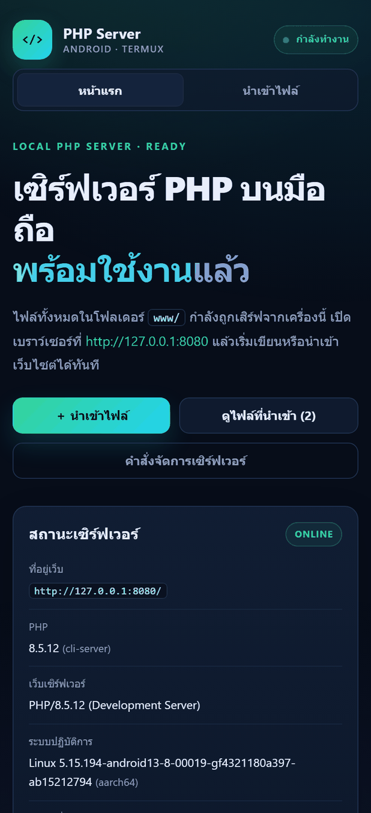
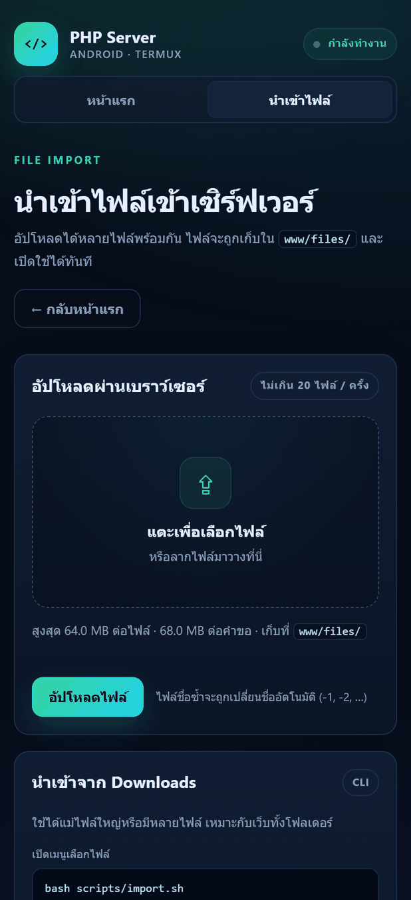
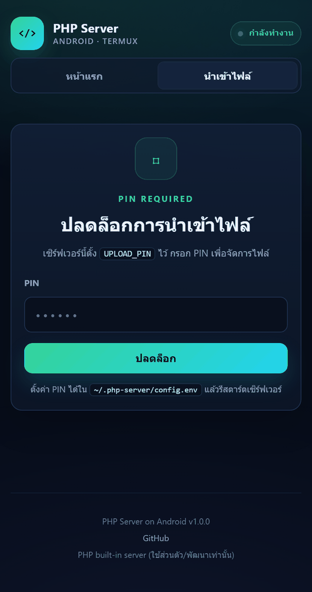
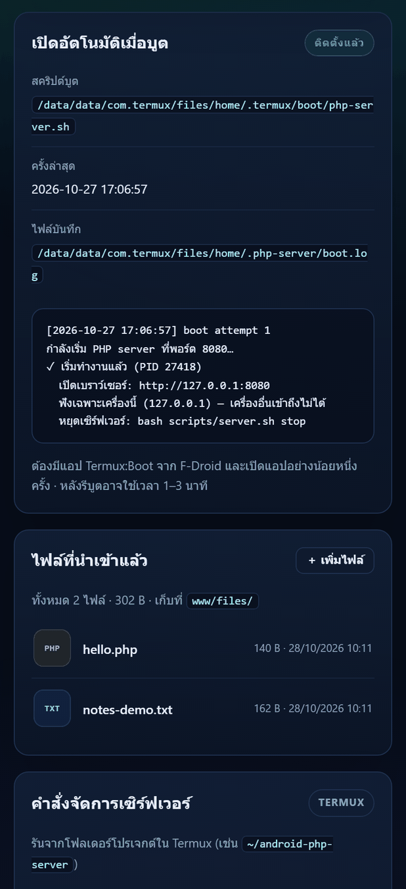
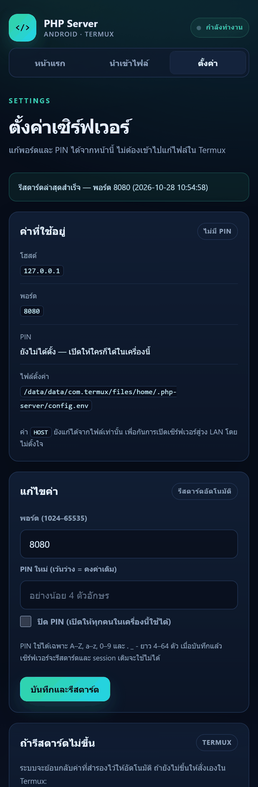
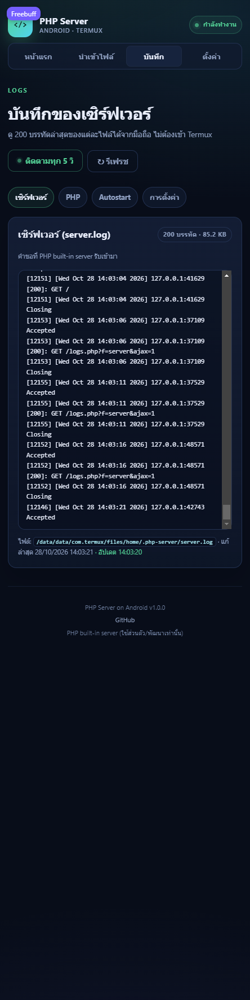
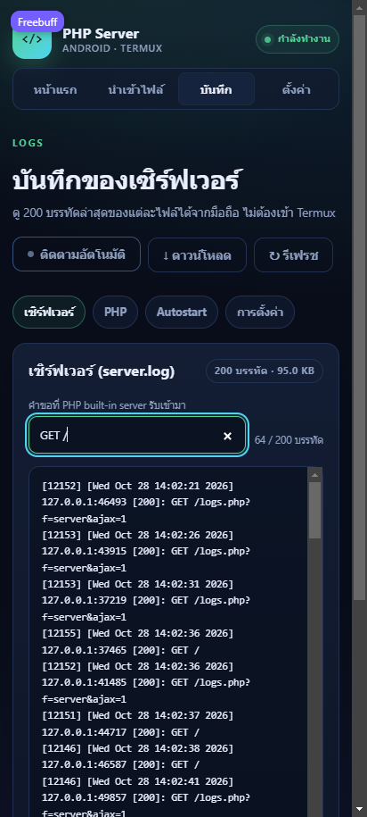
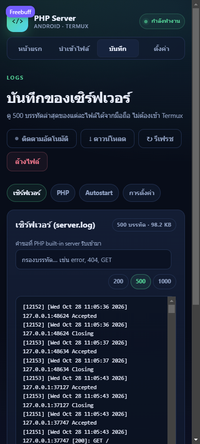
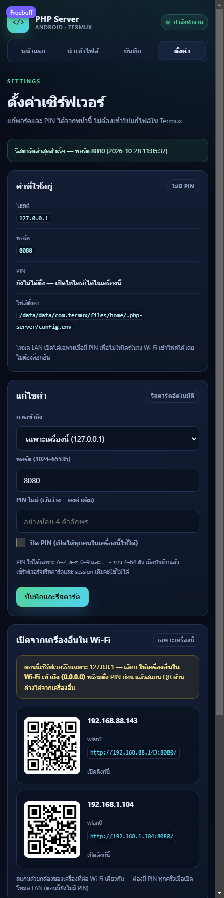

# PHP Server on Android (Termux)

รันเว็บ **PHP 8 บนมือถือ Android** ได้จริง โดยไม่ต้องรูท ไม่ต้องใช้คอมพิวเตอร์ และไม่ต้อง build APK
เปิดเว็บจาก `localhost` บนเครื่องนั้นได้ทันที พร้อมหน้า dashboard, ระบบนำเข้าไฟล์ผ่านเบราว์เซอร์,
สคริปต์นำเข้าจาก Downloads และคำสั่งเปิด–หยุดเซิร์ฟเวอร์ครบชุด

> **แนวทางที่เลือก: Termux + PHP CLI**
> Android ไม่มี PHP runtime ในตัว การ embed PHP binary ต้อง cross-compile สำหรับ ARM64 และดูแลต่อยาก
> Termux ให้ Linux environment พร้อมแพ็กเกจ PHP ที่ใช้งานได้จริงบนเครื่องไม่รูท จึงเป็นทางที่เสถียรและง่ายที่สุด

---

## จุดเด่น

- **PHP server จริง** ผ่าน PHP built-in server ที่ `127.0.0.1:8080`
- **Dashboard ภาษาไทย** แสดง PHP version, ระบบ, ดิสก์, เวลา, สถานะความพร้อม, ไฟล์ที่นำเข้า
  และการ์ด **เปิดอัตโนมัติเมื่อบูต** ที่อ่าน `boot.log` ล่าสุดให้ดูในหน้าเว็บเลย
- **อัปโหลดผ่านเว็บ** เลือกได้หลายไฟล์, ลากมาวาง, แถบความคืบหน้า, เปลี่ยนชื่ออัตโนมัติเมื่อชื่อซ้ำ
- **นำเข้าจาก Downloads** ทั้งไฟล์เดี่ยว โฟลเดอร์ และ ZIP ผ่านคำสั่งเดียว
- **จัดการเซิร์ฟเวอร์** ด้วย `start`, `stop`, `restart`, `status`, `logs`, `open`
- **เปิดอัตโนมัติเมื่อบูต** ด้วย Termux:Boot (ไม่บังคับ)
- **PIN + session** ป้องกันทั้งเว็บเมื่อเปิดให้เครื่องอื่นใน Wi-Fi เข้าถึง
- **หน้าตั้งค่าทางเว็บ** เปลี่ยนพอร์ต/PIN และเปิดโหมด LAN ได้จากเบราว์เซอร์ พร้อมรีสตาร์ตอัตโนมัติและย้อนกลับค่าเดิมถ้าพอร์ตใหม่ไม่ขึ้น
- **IP + QR code สำหรับ LAN** — หน้า settings แสดง IP ของ Wi-Fi ทุกอินเทอร์เฟซพร้อม QR ให้สแกนเปิดจากเครื่องอื่น
- **ดู log ผ่านเว็บ** — server, PHP errors, autostart และ settings เลือก 200/500/1000 บรรทัด พร้อมรีเฟรช โหมดติดตามทุก 5 วินาที ตัวกรองบรรทัด ดาวน์โหลด และล้างไฟล์
- **ความปลอดภัยพื้นฐาน** CSRF token, ปิด directory listing, กัน path traversal, บล็อกไฟล์ซ่อน
- **ตรวจ secrets ก่อน push** ด้วยสคริปต์ + git hook (`scripts/check-secrets.sh`)
- **ใช้แบบออฟไลน์ได้** หลังติดตั้งเสร็จ ไม่ต้องต่อเน็ตเพื่อรันเซิร์ฟเวอร์

---

## ภาพหน้าจอ

ภาพทั้งหมดถ่ายจากมือถือ Android จริงที่ความกว้างหน้าจอ 412 px (Chrome บน Xiaomi 23113RKC6G,
Android 16 / HyperOS, PHP 8.5.12 ใน Termux จาก F-Droid)

| หน้าแรก — สถานะเซิร์ฟเวอร์ | นำเข้าไฟล์ผ่านเบราว์เซอร์ |
|---|---|
|  |  |
| **หน้า PIN (เมื่อตั้ง `UPLOAD_PIN`)** | **การ์ด autostart + `boot.log`** |
|  |  |

**หน้าตั้งค่า** — เปลี่ยนพอร์ต/PIN และเปิดโหมด LAN ได้จากเบราว์เซอร์ ระบบรีสตาร์ตให้อัตโนมัติ
และย้อนกลับค่าเดิมถ้าพอร์ตใหม่ไม่ตอบสนอง



**หน้าบันทึก (logs)** — ดู 200 บรรทัดล่าสุดของ server.log, php-error.log, boot.log และ settings.log
กด **ติดตามทุก 5 วิ** เพื่อให้หน้าเว็บดึงบรรทัดใหม่เองโดยไม่ต้องรีเฟรช



พิมพ์คำค้นในช่อง **กรองบรรทัด** เพื่อดูเฉพาะบรรทัดที่ต้องการ (ใช้ร่วมกับโหมดติดตามได้)
หรือกด **ดาวน์โหลด** เพื่อเก็บไฟล์ log เต็มไว้ตรวจภายหลัง



เลือกจำนวนบรรทัดที่แสดง (200 / 500 / 1000) ได้จากปุ่มเหนือรายการ และกด **ล้างไฟล์**
เมื่อ log บวมเกินไป (มีกล่องยืนยันก่อนลบ)



**QR code ในหน้าตั้งค่า** — สแกนเพื่อเปิดเซิร์ฟเวอร์จากมือถือ/แท็บเล็ตเครื่องอื่นใน Wi-Fi เดียวกัน



---

## สถาปัตยกรรม

```text
┌──────────────────────────── Android phone ────────────────────────────┐
│                                                                      │
│  Termux (Linux userland, ไม่ต้องรูท)                                 │
│    └─ PHP 8 built-in server  ── 127.0.0.1:8080                        │
│         ├─ router.php   → auth (ถ้าตั้ง PIN), /healthz, กัน path       │
│         └─ www/                                                      │
│              ├─ index.php    → dashboard                             │
│              ├─ upload.php   → นำเข้า/ลบไฟล์ผ่านเว็บ                 │
│              ├─ files/       → ไฟล์และเว็บไซต์ที่นำเข้า              │
│              └─ assets/      → CSS, JS, icon                         │
│                                                                      │
│  Chrome / เบราว์เซอร์อื่น  ── http://127.0.0.1:8080                   │
└──────────────────────────────────────────────────────────────────────┘
```

PHP built-in server เหมาะกับ **การพัฒนาและใช้งานส่วนตัว** ไม่ใช่มืออาชีพ/Production
(ไม่มี TLS, ไม่ได้ออกแบบมาสำหรับภาระงานหนัก) ห้ามเปิดพอร์ตนี้สู่อินเทอร์เน็ต

---

## สิ่งที่ต้องเตรียม

- มือถือ Android ที่ติดตั้งแอปจาก F-Droid ได้ (Android 7 ขึ้นไป)
- พื้นที่ว่างประมาณ 100 MB (ไม่รวมไฟล์เว็บที่นำเข้า)
- ไม่ต้องรูท
- ว่าง่าย ๆ: ใช้ Chrome หรือเบราว์เซอร์อื่นในเครื่องเปิด `http://127.0.0.1:8080`

> **สำคัญ:** ติดตั้ง Termux จาก **F-Droid** เท่านั้น
> เวอร์ชันบน Google Play เลิกดูแลแล้วและแพ็กเกจอาจติดตั้งไม่ได้
> หากเคยติดตั้งจาก Play Store ให้ถอนออกก่อน แล้วติดตั้งจาก F-Droid แทน

ลิงก์:
- F-Droid: <https://f-droid.org/>
- Termux: <https://f-droid.org/packages/com.termux/>
- Termux:Boot (ไม่บังคับ): <https://f-droid.org/packages/com.termux.boot/>

---

## เริ่มใช้งานแบบ Step-by-Step

### ขั้นที่ 1 — ติดตั้ง Termux

1. ติดตั้ง **F-Droid** จาก <https://f-droid.org/> (ถ้ายังไม่มี)
2. เปิด F-Droid ค้นหา **Termux** แล้วกดติดตั้ง
3. ถ้าต้องการเปิดเซิร์ฟเวอร์อัตโนมัติเมื่อบูต ให้ติดตั้ง **Termux:Boot** ไว้ด้วย
4. เปิดแอป Termux หนึ่งครั้ง

### ทางลัด (ทางเลือก) — ติดตั้งด้วยคำสั่งเดียว

ถ้าไม่อยากทำทีละขั้น ให้เปิด Termux แล้วรัน:

```bash
curl -fsSL https://raw.githubusercontent.com/NarDecH/android-php-server/main/scripts/bootstrap.sh | bash
```

สคริปต์จะติดตั้ง `git` ให้ ดาวน์โหลดโปรเจกต์ไปที่ `~/android-php-server` แล้วรัน
`scripts/setup.sh` ให้เสร็จ (ติดตั้ง PHP/curl/unzip และสร้างไฟล์ตั้งค่า)
จากนั้นข้ามไปทำต่อที่ **ขั้นที่ 4** ได้เลย — รันซ้ำเมื่อไรจะเป็นการอัปเดตโค้ดให้เอง

### ขั้นที่ 2 — เตรียม Termux และดาวน์โหลดโปรเจกต์

คัดลอกคำสั่งนี้ทีละบล็อกลงใน Termux:

```bash
pkg update -y && pkg upgrade -y
pkg install -y git php curl unzip
termux-setup-storage
```

- `termux-setup-storage` จะมีหน้าต่างขออนุญาตเข้าถึงไฟล์ → กด **Allow**
- ขั้นนี้ทำให้เข้าถึงโฟลเดอร์ `~/storage/downloads` ได้

จากนั้นดาวน์โหลดโปรเจกต์:

```bash
cd ~
git clone https://github.com/NarDecH/android-php-server.git
cd android-php-server
```

### ขั้นที่ 3 — ติดตั้งและตั้งค่า

```bash
bash scripts/setup.sh
```

สคริปต์จะติดตั้ง `php`, `curl`, `unzip` (ถ้ายังไม่มี), สร้างโฟลเดอร์ `www/files/`
และสร้างไฟล์ตั้งค่า `~/.php-server/config.env` ให้อัตโนมัติ

ตรวจสอบว่า PHP ใช้งานได้:

```bash
php -v
```

### ขั้นที่ 4 — เริ่มเซิร์ฟเวอร์

```bash
bash scripts/server.sh start
```

จะเห็นข้อความประมาณนี้:

```text
✓ เริ่มทำงานแล้ว (PID 12345)
  เปิดเบราว์เซอร์: http://127.0.0.1:8080
```

เปิดเบราว์เซอร์ในมือถือไปที่ **<http://127.0.0.1:8080>**
หรือให้ Termux เปิดให้อัตโนมัติ:

```bash
bash scripts/server.sh open
```

ถ้าเปิดได้จะเห็น dashboard แสดง PHP version, สถานะระบบ, พื้นที่ดิสก์ และไฟล์ที่นำเข้า

### ขั้นที่ 5 — นำเข้าไฟล์

เลือกวิธีใดวิธีหนึ่ง:

**วิธีที่ 1: ผ่านหน้าเว็บ (ง่ายที่สุด)**

1. เปิด <http://127.0.0.1:8080/upload.php>
2. แตะเลือกไฟล์ หรือลากไฟล์มาวาง
3. กด **อัปโหลดไฟล์**
4. ไฟล์จะอยู่ที่ `www/files/<ชื่อไฟล์>` และเปิดได้ทันที


**วิธีที่ 2: นำเข้าจาก Downloads**

คัดลอกไฟล์หรือ ZIP ไว้ใน Downloads ของมือถือ แล้วรัน:

```bash
bash scripts/import.sh
```

จะเห็นเมนูให้เลือกไฟล์ใน Downloads จากนั้นกดหมายเลข:

```text
ไฟล์ใน Downloads:
   1) mysite.zip  (2.4M)
   2) index.php   (1.2K)
เลือกหมายเลข (q = ยกเลิก): 1
```

หรือระบุ path ตรง ๆ:

```bash
bash scripts/import.sh ~/storage/downloads/mysite.zip
bash scripts/import.sh ~/storage/downloads/photo.jpg --to assets
```

ไฟล์ทั้งหมดจะถูกเก็บใต้ `www/files/` เพื่อไม่ทับหน้า dashboard
ถ้า ZIP มีโฟลเดอร์ชั้นใน ให้เปิด URL ตามโครงสร้างจริง เช่น
`http://127.0.0.1:8080/files/mysite/`

### ขั้นที่ 6 — หยุด ตรวจสอบ และเปิดใหม่

```bash
bash scripts/server.sh status    # ดูสถานะ + health check
bash scripts/server.sh stop      # หยุดเซิร์ฟเวอร์
bash scripts/server.sh restart   # ใช้หลังแก้ config
bash scripts/server.sh logs      # ดู log ล่าสุด
```

### ขั้นที่ 7 (ไม่บังคับ) — เปิดเซิร์ฟเวอร์อัตโนมัติเมื่อบูต

1. ติดตั้ง **Termux:Boot** จาก F-Droid
2. เปิดแอป Termux:Boot อย่างน้อยหนึ่งครั้ง
3. กลับมาที่ Termux แล้วรัน:

```bash
cd ~/android-php-server
bash scripts/install-boot.sh
```

4. แนะนำให้ปิด **Battery optimization** ให้ Termux (Settings → Apps → Termux → Battery → Unrestricted)
5. รีบูตเครื่อง แล้วรอประมาณ 10–20 วินาที เปิด `http://127.0.0.1:8080` ได้เลย

ยกเลิกการเปิดอัตโนมัติ:

```bash
bash scripts/install-boot.sh --remove
```

> Android อาจปิดโปรเซสเบื้องหลังได้แม้เปิด wake lock ไว้ หากระบบจัดการแบตเตอรี่เข้มงวด
> วิธีที่ชัวร์ที่สุดคือเปิด Termux ค้างไว้แล้วรัน `bash scripts/server.sh start` เอง

---

## คำสั่งที่ใช้บ่อย

| งาน | คำสั่ง |
|---|---|
| เริ่มเซิร์ฟเวอร์ | `bash scripts/server.sh start` |
| หยุด | `bash scripts/server.sh stop` |
| เริ่มใหม่หลังแก้ config | `bash scripts/server.sh restart` |
| ดูสถานะ | `bash scripts/server.sh status` |
| ดู log | `bash scripts/server.sh logs` |
| เปิดเบราว์เซอร์ | `bash scripts/server.sh open` |
| ดู URL | `bash scripts/server.sh url` |
| ดูค่าตั้งค่า (ซ่อน PIN) | `bash scripts/server.sh config` |
| นำเข้าไฟล์แบบมีเมนู | `bash scripts/import.sh` |
| นำเข้าไฟล์/ZIP ตรง ๆ | `bash scripts/import.sh <path>` |
| ดูไฟล์ที่นำเข้า | `bash scripts/import.sh --list` |
| ติดตั้งเปิดอัตโนมัติ | `bash scripts/install-boot.sh` |

---

## การตั้งค่า

ไฟล์ตั้งค่าอยู่ที่:

```text
~/.php-server/config.env
```

แก้ไขด้วย `nano` (ติดตั้งก่อนถ้ายังไม่มี: `pkg install nano`):

```bash
nano ~/.php-server/config.env
```

ค่าเริ่มต้น:

```bash
HOST=127.0.0.1        # 127.0.0.1 = เฉพาะเครื่องนี้, 0.0.0.0 = ให้เครื่องอื่นใน Wi-Fi เข้าถึง
PORT=8080
PHP_WORKERS=4         # จำนวน worker ของ built-in server
APP_TZ=Asia/Bangkok
MAX_UPLOAD_MB=64      # ขนาดสูงสุดต่อไฟล์
UPLOAD_PIN=           # ว่าง = ไม่มี PIN
```

**ทุกครั้งที่แก้ config ต้องรัน:**

```bash
bash scripts/server.sh restart
```

### เปลี่ยนพอร์ต

แก้ `PORT=8081` แล้ว `restart` จากนั้นเปิด `http://127.0.0.1:8081`

### ตั้ง PIN

แก้บรรทัด:

```bash
UPLOAD_PIN=รหัสของคุณ
```

แล้ว `restart` — เมื่อตั้ง PIN แล้ว **ทุกหน้าและทุกไฟล์ในเว็บจะต้องปลดล็อกก่อน**
(ยกเว้นหน้า login และไฟล์ CSS/JS ที่ใช้แสดงหน้า login)
ปุ่ม **ล็อกเอาต์** อยู่ในการ์ดความปลอดภัยในหน้า `upload.php`

---

## เปิดให้เครื่องอื่นใน Wi-Fi เข้าถึง (ไม่บังคับ)

ใช้เมื่ออยากเปิดเว็บจากคอมพิวเตอร์หรือแท็บเล็ตในวงเดียวกัน

1. แก้ config:

```bash
nano ~/.php-server/config.env
```

```bash
HOST=0.0.0.0
UPLOAD_PIN=ตั้งรหัสที่คาดเดายาก
```

2. รีสตาร์ต:

```bash
bash scripts/server.sh restart
```

3. เปิดหน้า **ตั้งค่า** ในเว็บ (เมนูบนสุด) — การ์ด **เปิดจากเครื่องอื่นใน Wi-Fi**
   จะแสดง IP ของทุกอินเทอร์เฟซพร้อม **QR code** ให้สแกนจากเครื่องอื่นได้ทันที
   (ถ้าไม่เห็น IP ให้ตรวจว่ามือถือต่อ Wi-Fi อยู่ แล้วรีเฟรชหน้า)
4. หรือเปิดจากเครื่องอื่นด้วยการพิมพ์ที่อยู่:

```text
http://<IP-ของมือถือ>:8080
```

ตัวอย่าง: `http://192.168.1.25:8080`

ข้อควรระวัง:

- ใช้ได้เฉพาะอุปกรณ์ที่อยู่ใน Wi-Fi เดียวกัน (ถ้า router เปิด AP isolation อาจเชื่อมไม่ได้)
- อย่า port-forward พอร์ตนี้จาก router สู่อินเทอร์เน็ต
- เป็น HTTP ไม่มี TLS — ไม่ควรใช้กับข้อมูลอ่อนไหว
- ไฟล์ `.php` ที่นำเข้าจะถูก execute ด้วยสิทธิ์ของแอป Termux
- เมื่อไม่ได้ตั้ง PIN หน้าเว็บและไฟล์ทั้งหมดจะเปิดให้ทุกคนในวงเน็ตเวิร์กเห็น
- PIN ป้องกันหน้าเว็บและไฟล์ผ่าน browser แต่ไม่ได้เข้ารหัสการรับส่งข้อมูล

---

## ความปลอดภัย

- ค่าเริ่มต้นฟังเฉพาะ `127.0.0.1` — เครื่องอื่นเข้าถึงไม่ได้
- `router.php` กัน path traversal, บล็อกไฟล์ซ่อน/ไฟล์ภายใน และปิด directory listing
- ฟอร์ม POST ทุกฟอร์มมี CSRF token
- เมื่อตั้ง `UPLOAD_PIN` ระบบใช้ session cookie (`HttpOnly`, `SameSite=Lax`) ครอบทั้งเว็บ
- ระบบ **อนุญาตให้อัปโหลด `.php` โดยเจตนา** เพราะใช้ import เว็บ PHP — อัปโหลดเฉพาะโค้ดที่ไว้ใจได้
- PHP built-in server ใช้สำหรับพัฒนา/ส่วนตัวเท่านั้น ไม่ควรใช้เป็น public server
- แอปอื่นบนเครื่องอาจเข้าถึง `127.0.0.1` ได้ในทางทฤษฎี หากกังวลให้ตั้ง PIN ไว้เสมอ

---

## โครงสร้างโปรเจกต์

```text
android-php-server/
├── README.md
├── router.php                 # router ของ PHP built-in server
├── www/
│   ├── index.php              # dashboard + สถานะเซิร์ฟเวอร์
│   ├── upload.php             # อัปโหลด/ลบไฟล์ + login PIN
│   ├── settings.php           # เปลี่ยนพอร์ต/PIN/HOST + IP & QR สำหรับ LAN
│   ├── logs.php               # ดู log 4 ไฟล์ + โหมดติดตามอัตโนมัติ
│   ├── _lib.php               # ฟังก์ชันและ layout ที่ใช้ร่วมกัน
│   ├── assets/
│   │   ├── app.css
│   │   ├── app.js
│   │   ├── icon.svg
│   │   └── vendor/qrcode.js   # สร้าง QR ฝั่งเบราว์เซอร์ (MIT)
│   └── files/                 # ไฟล์ที่นำเข้า (ไม่ commit ขึ้น Git)
├── scripts/
│   ├── setup.sh               # ติดตั้ง PHP และสร้าง config
│   ├── server.sh              # start/stop/restart/status/logs/open
│   ├── import.sh              # นำเข้าจาก Downloads (ไฟล์/โฟลเดอร์/ZIP)
│   ├── apply-settings.sh      # รีสตาร์ตหลังแก้ค่าจากหน้าเว็บ + ย้อนกลับถ้าล้มเหลว
│   ├── check-secrets.sh       # สแกน secrets ก่อน push (+ ติดตั้ง git hook)
│   └── install-boot.sh        # ติดตั้ง Termux:Boot wrapper
├── docs/
│   ├── installation.md        # ติดตั้งละเอียด
│   ├── usage.md               # ใช้งานและตั้งค่าละเอียด
│   └── troubleshooting.md     # แก้ปัญหา
├── .gitignore
└── .gitattributes
```

---

## แก้ปัญหาเบื้องต้น

| อาการ | สาเหตุ/วิธีแก้ |
|---|---|
| `php: command not found` | รัน `bash scripts/setup.sh` หรือ `pkg install php` |
| `CANNOT LINK EXECUTABLE "php"` | แพ็กเกจ Termux คนละรุ่น → รัน `bash scripts/setup.sh` (ซ่อมด้วย `apt` ให้อัตโนมัติ) |
| `Address already in use` | พอร์ต 8080 ถูกใช้อยู่ → เปลี่ยน `PORT` ใน config แล้ว restart |
| เปิด localhost ไม่ได้ | `bash scripts/server.sh status` และ `logs`; ตรวจว่าได้ `start` แล้ว |
| อัปโหลดไฟล์ใหญ่ไม่ได้ | เพิ่ม `MAX_UPLOAD_MB` แล้ว restart (ค่าเริ่มต้น 64 MB) |
| เปิดจากคอมไม่ได้ | ตั้ง `HOST=0.0.0.0`, อยู่ Wi-Fi เดียวกัน, ตรวจ IP และ firewall/AP isolation |
| เซิร์ฟเวอร์หยุดเมื่อปิดจอ | เปิด wake lock, ปิด battery optimization ให้ Termux |
| หน้า login วนซ้ำ | ต้องอนุญาต cookie; ลองเปิดใน Chrome ปกติ/ล้างข้อมูลเว็บ |
| ไฟล์ PHP แสดงเป็นข้อความ | ตรวจว่าเปิดผ่านเซิร์ฟเวอร์ ไม่ได้เปิดไฟล์จาก file manager |
| `Permission denied` ตอนรันสคริปต์ | ใช้ `bash scripts/...` หรือ `chmod +x scripts/*.sh` |
| ติดตั้ง Termux จาก Play Store | ถอน แล้วติดตั้งจาก F-Droid ใหม่ |

ดูรายละเอียดเพิ่มเติมที่ [docs/troubleshooting.md](docs/troubleshooting.md)

---

## เอกสารเพิ่มเติม

- [ติดตั้งแบบละเอียด (installation.md)](docs/installation.md)
- [วิธีใช้งานและตั้งค่าทั้งหมด (usage.md)](docs/usage.md)
- [แก้ปัญหา (troubleshooting.md)](docs/troubleshooting.md)

---

## คำถามที่พบบ่อย

**ต้องรูทมือถือไหม?**
ไม่ต้อง Termux ทำงานใน sandbox ของแอปปกติ

**ใช้ได้ตอนไม่มีอินเทอร์เน็ตไหม?**
ได้ หลังติดตั้งและ clone โปรเจกต์เสร็จแล้ว เซิร์ฟเวอร์ทำงานในเครื่องทั้งหมด

**ใช้แทน hosting ได้ไหม?**
ไม่แนะนำ นี่คือ development server สำหรับทดลอง/ใช้งานส่วนตัว

**ใช้ฐานข้อมูลได้ไหม?**
ตัวโปรเจกต์ไม่รวมฐานข้อมูล แต่ Termux ติดตั้ง MariaDB/SQLite เพิ่มได้หากต้องการ
(ควรศึกษาเพิ่มเติมเรื่อง PHP extensions และการรัน service บน Android)

**เปลี่ยนหน้าแรกได้ไหม?**
ได้ แก้ `www/index.php` หรือวางเว็บของคุณใน `www/files/<ชื่อเว็บ>/`
ถ้าจะเขียนทับ `www/index.php` ควรสำรอง dashboard ไว้ก่อน

**ทำไมใช้ Termux ไม่ทำเป็น APK?**
เพราะ PHP ต้องใช้ binary ที่ compile สำหรับ Android โดยเฉพาะ การทำ APK ที่ embed PHP
ต้องดูแล binary, สถาปัตยกรรม CPU และ security patch เอง ซึ่งซับซ้อนกว่ามาก
Termux ใช้แพ็กเกจ PHP ที่ maintain อยู่แล้ว จึงเหมาะกับโปรเจกต์นี้ที่สุด

---

## การทดสอบ

ทดสอบบนมือถือ Android จริง (Xiaomi 23113RKC6G, Android 16/HyperOS, Termux 0.118.3,
PHP 8.5.12) แล้ว:

- dashboard, health check, อัปโหลด/ลบไฟล์ และการ execute ไฟล์ PHP
- นำเข้าไฟล์เดี่ยวและ ZIP ด้วย `import.sh` แล้วเปิดผ่าน HTTP
- PIN: redirect เมื่อยังไม่ล็อกอิน, ใส่ PIN, cookie และ logout
- `start` / `stop` / `restart` / `status` และตรวจว่าไม่มี worker หรือพอร์ตค้างหลัง stop
- `setup.sh` ซ่อม PHP/libcurl ที่ link ไม่ได้ และไม่ค้างที่คำถาม `openssl.cnf` (force-confold)
- boot script ด้วย environment แบบน้อยที่สุด (`PATH=/system/bin`) และ shebang แบบ path เต็ม
- **autostart หลังรีบูตจริง** ด้วย Termux:Boot 0.8.1: `boot.log` มี attempt และ `/healthz` ตอบ 200
- `server.sh status` จาก process ของ Termux รายงานกำลังทำงาน และอ่าน `~/storage/downloads` ได้
- กัน path traversal, ไฟล์ซ่อน, `_lib.php` และ directory listing
- หน้า logs: โหมดติดตามอัตโนมัติอัปเดตบรรทัดใหม่ทุก 5 วินาที (หยุดเมื่อสลับแท็บ/ปิดโหมด) และเลื่อนตามเมื่ออยู่ท้าย log
- ตัวกรองบรรทัดทำงานร่วมกับโหมดติดตาม (บรรทัดใหม่ที่ตรงเงื่อนไขขึ้นเอง) และปุ่มดาวน์โหลดส่งไฟล์เต็มที่ `Content-Length` ตรงกับไบต์จริง
- endpoint ดาวน์โหลด/AJAX ของ logs ถูก PIN กันเหมือนหน้าอื่น (302 → `upload.php` เมื่อยังไม่ล็อกอิน)
- ตัวเลือก 200/500/1000 บรรทัดคืนจำนวนตรงตามที่เลือก (ทั้งหน้าเว็บและ AJAX), ค่าที่ไม่รู้จักกลับเป็น 200
- ล้าง log: CSRF ผิดไม่แตะไฟล์, CSRF ถูกไฟล์เหลือ 0 ไบต์, เขียนใหม่หลังล้างไม่มี NUL ค้าง (log เปิดแบบ append)
- หน้า logs ทดสอบบน Chrome ของมือถือจริงแล้ว (ภาพข้างบนถ่ายจากเครื่อง)
- หน้า settings: อ่าน IP ของ Wi-Fi ด้วย `net_get_interfaces()` (Termux อ่าน `/proc/net/fib_trie` ไม่ได้)
  และ QR ที่สร้างในเบราว์เซอร์ถอดรหัสกลับเป็น URL ถูกต้องทั้งสองอินเทอร์เฟซ
- โหมด LAN บนพอร์ตทดสอบ: เรียกผ่าน IP จริงของเครื่องได้, PIN ยังกันหน้าเว็บ (302) และล็อกอินผ่าน IP นั้นได้

รอบทดสอบสุดท้ายติดตั้งใหม่ทั้งหมดด้วย **Termux 0.118.3 และ Termux:Boot 0.8.1
จาก F-Droid แบบทางการ** (release build ที่ไม่ debuggable, ลายเซ็น F-Droid, shared UID เดียวกัน)
แล้วตั้งค่าด้วย `setup.sh` + `install-boot.sh`:

- `setup.sh` บน Termux ที่เพิ่งติดตั้งใหม่ ติดตั้ง PHP 8.5.12 ให้เสร็จในครั้งเดียว
- รีบูตจริง: `boot.log` แสดง `boot attempt 1` แล้วเริ่มเซิร์ฟเวอร์สำเร็จ (`/healthz` = 200)
  ภายใน ~1 นาที 45 วินาทีหลังออกคำสั่งรีบูต (พอร์ตพร้อมใช้ก่อนหน้านั้นเล็กน้อย)
- `import.sh` นำเข้าไฟล์จาก `~/storage/downloads` แล้วเปิดผ่าน HTTP ได้ (`import-ok 8.5.12`)

หลังติดตั้งด้วยคำสั่งเดียว (`scripts/bootstrap.sh`) บนเครื่องจริง:

- ติดตั้งจากศูนย์ได้ในครั้งเดียว: `git` → clone → `setup.sh` (ใช้ config เดิมถ้ามี) → สิทธิ์ไฟล์ครบ
- การ์ด **เปิดอัตโนมัติเมื่อบูต** แสดง "ติดตั้งแล้ว", เวลา attempt ล่าสุด และ `boot.log` จริงบนหน้าจอ
- ชุดทดสอบ PIN + ไฟล์ผ่าน HTTP ผ่านทั้ง 9 ข้อ: redirect ตอนยังไม่ล็อกอิน, CSRF token,
  PIN ผิดถูกปฏิเสธ, PIN ถูกเข้า dashboard ได้, อัปโหลด–เสิร์ฟ–ลบไฟล์, logout แล้วถูกกันอีกครั้ง

หมายเหตุ: HyperOS ของเครื่องทดสอบบล็อก `adb input` และ `pm grant` จึงให้สิทธิ์ storage
ผ่าน `adb shell appops` และส่งคำสั่งเข้าหน้าจอ Termux ด้วยคีย์บอร์ด HID เสมือนระดับ kernel
(uhid) ซึ่งเทียบเท่ากับการที่ผู้ใช้พิมพ์เองบนเครื่อง — สำหรับผู้ใช้จริงให้รัน
`termux-setup-storage` แล้วกด Allow ตามคู่มือ

ตรวจ syntax PHP ด้วย `php -l` ทุกไฟล์; หาก PHP ใน Termux ต่างรุ่น สามารถตรวจซ้ำได้ด้วย
`php -l www/index.php`

---

## สัญญาอนุญาต

โปรเจกต์นี้เผยแพร่เพื่อการเรียนรู้และการใช้งานส่วนตัว
สามารถ fork และปรับใช้ได้ตามต้องการ

โปรเจกต์ใช้ [qrcode-generator](https://github.com/kazuhikoarase/qrcode-generator)
ของ Kazuhiko Arase (MIT License) โดยคัดลอกไฟล์ `qrcode.js` ไว้ที่ `www/assets/vendor/`
เพื่อให้สร้าง QR ได้แม้ไม่มีอินเทอร์เน็ต — ไฟล์ต้นฉบับมีข้อความสัญญาอนุญาตอยู่ในหัวไฟล์
